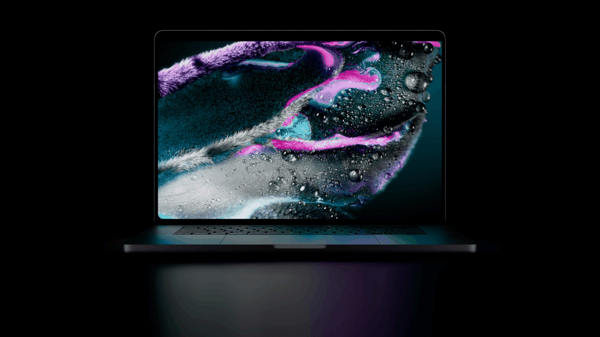

## About

I’m [Aayush](https://github.com/beast955). I like exploring ideas, learning by building, and making useful things one commit at a time.

- **Currently exploring:** [practical tools and learning by shipping](https://github.com/beast955?tab=repositories)
- **Building:** NovaStore, FDR Shield, and more
- **Say hi:** [GitHub Discussions](https://github.com/beast955/discussions)

## Selected projects

| Project | About |
|:--|:--|
| [🛍️ **NovaStore**](https://github.com/beast955/NovaStore) | A web project in the works. |
| [🛡️ **FDR Shield**](https://github.com/beast955/FDR-Shield) | A project in progress. |
| [✦ **More projects**](https://github.com/beast955?tab=repositories) | Browse my other builds and experiments. |

## GitHub stats

 

 

[Open an issue](https://github.com/beast955/issues) if you’d like to build something together.

